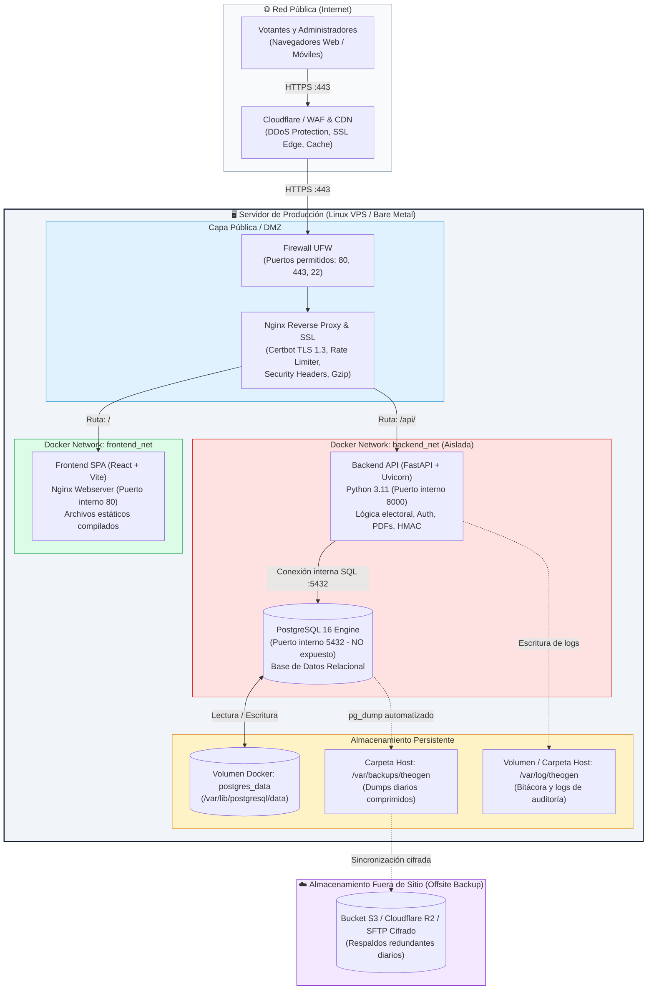

# 01. Arquitectura de Infraestructura para Producción
### TheoGen Electoral — Participación transparente y verificable

Este documento define la arquitectura de infraestructura recomendada para la operación en producción de **TheoGen Electoral**. La plataforma está concebida para garantizar la **alta disponibilidad**, la **confidencialidad del voto**, la **integridad de las actas y bitácoras** y un **rendimiento óptimo** durante picos de concurrencia en jornadas de votación.

---

## 🏛️ 1. Diagrama de Arquitectura de Producción

El siguiente diagrama detalla la segmentación de red, el flujo de peticiones y el aislamiento de servicios mediante contenedores Docker y redes privadas virtuales.

---

## 🧩 2. Componentes del Stack Tecnológico

### 2.1. Capa Perimetral y Proxy Reverso (Nginx / Cloudflare)
- **Terminación SSL/TLS:** Soporte estricto para TLS 1.2 y TLS 1.3 con certificados renovados automáticamente mediante Let's Encrypt (Certbot).
- **Control de Tasa (Rate Limiting):**
  - Votación pública (`/api/voting/vote`): Máximo 5 peticiones por segundo por IP, con ráfaga (*burst*) controlada para prevenir ataques de fuerza bruta o saturación maliciosa.
  - Autenticación administrativa (`/api/auth/token`): Máximo 5 intentos por minuto para mitigar ataques de contraseña.
- **Cabeceras de Seguridad:** Inyección de `Content-Security-Policy`, `X-Frame-Options: DENY`, `X-Content-Type-Options: nosniff`, `Strict-Transport-Security` (HSTS) y `Referrer-Policy`.
- **Compresión HTTP:** Gzip y Brotli para transferencia ultra rápida de recursos estáticos (JavaScript, CSS, imágenes).

### 2.2. Capa Frontend (React 18 + Vite + MUI)
- **Tipo de Entrega:** Single Page Application (SPA) compilada en HTML/JS/CSS estático minificado.
- **Servidor Web:** Imagen `nginx:alpine` ligera (< 25 MB) optimizada para servir estáticos con caché del navegador (`Cache-Control`) y reescritura hacia `index.html` para el enrutador cliente.
- **Sin estado (*Stateless*):** No mantiene sesiones en servidor; la autenticación se gestiona con tokens JWT en cliente.

### 2.3. Capa Backend (FastAPI + ASGI Uvicorn)
- **Runtime:** Python 3.11 en contenedor optimizado basado en Debian `python:3.11-slim`.
- **Servidor ASGI:** Uvicorn con múltiples workers (`--workers 4` o según núcleos de CPU) supervisados para procesamiento asíncrono no bloqueante.
- **Mecanismos Críticos:**
  - `HMAC-SHA256`: Firma criptográfica con clave secreta (`VOTE_HMAC_KEY`) generada en servidor para cada comprobante de votación.
  - `ReportLab`: Motor local para renderizado de actas electorales oficiales en formato PDF con huella digital.
  - `Validador RUT Módulo 11`: Validación algorítmica local del padrón electoral chileno.
  - `Lifespan & Migraciones`: Inicialización segura del esquema en arranque con verificación del estado de conexión (`pool_pre_ping=True`).

### 2.4. Capa de Base de Datos (PostgreSQL 16)
- **Motor:** PostgreSQL 16 Alpine con transacciones ACID completas.
- **Aislamiento Total:** El puerto `5432` **no se publica** al exterior del host. Únicamente los contenedores dentro de la red privada `backend_net` tienen visibilidad.
- **Almacenamiento:** Volumen de Docker con nombre (`postgres_data`) montado sobre almacenamiento rápido SSD/NVMe del host.
- **Healthcheck:** Verificación periódica activa mediante `pg_isready` cada 5 segundos para garantizar que el backend no atienda tráfico antes de que la base de datos esté lista.

---

## 💻 3. Dimensionamiento y Requisitos de Hardware

Para determinar el tamaño del servidor (*sizing*), se consideran 3 niveles de carga según el tamaño del padrón y el número estimado de votantes simultáneos:

| Escala de Elección | Padrón Electoral | Votantes Simultáneos Pico | CPU recomendada | Memoria RAM | Almacenamiento SSD | Ancho de Banda |
|---|---|---|---|---|---|---|
| **Nivel 1: Institución Pequeña** (Centro de Alumnos, Club) | Hasta 1.000 | 10 - 25 req/seg | 2 vCPU | 4 GB | 25 GB SSD | 1 Gbps compartido |
| **Nivel 2: Colegio / Organización Mediana** (Típico) | 1.000 - 8.000 | 50 - 150 req/seg | 4 vCPU | 8 GB | 50 GB SSD NVMe | 1 Gbps dedicado |
| **Nivel 3: Jornada Masiva / Multi-colegio** | 8.000 - 50.000+ | 250 - 600 req/seg | 8 vCPU | 16 GB | 100 GB SSD NVMe | 2 Gbps dedicado |

> [!TIP]
> **Consumo de Memoria por Componente (en régimen estándar):**
> - Nginx Reverse Proxy: ~25 MB RAM
> - Frontend Web (Nginx SPA): ~15 MB RAM
> - Backend FastAPI (4 workers): ~250 - 450 MB RAM
> - PostgreSQL 16 (con shared buffers = 512 MB): ~600 - 1.200 MB RAM
> - Sistema Operativo Linux (Ubuntu Server): ~400 MB RAM
>
> **Total en reposo:** ~1.3 GB RAM. Un servidor con **4 GB RAM** opera con holgura para el Nivel 1 y 2.

---

## 🌐 4. Matriz de Puertos y Reglas de Red

| Servicio | Puerto Interno | Puerto Host / Externo | Protocolo | Acceso Permitido | Propósito |
|---|---|---|---|---|---|
| **SSH** | 22 | 22 (o puerto personalizado) | TCP | Solo IPs administradoras / VPN | Administración del servidor Linux |
| **HTTP** | 80 | 80 | TCP | Público (Internet) | Redirección 301 obligatoria hacia HTTPS |
| **HTTPS** | 443 | 443 | TCP | Público (Internet) | Tráfico seguro de la plataforma electoral |
| **Frontend Web** | 80 | 3000 (solo localhost) | TCP | Solo Nginx Reverse Proxy | Servir bundle estático de React |
| **Backend API** | 8000 | 8000 (solo localhost) | TCP | Solo Nginx Reverse Proxy | API REST FastAPI |
| **PostgreSQL** | 5432 | **Ninguno** (Bloqueado) | TCP | Solo red Docker `backend_net` | Motor de base de datos relacional |

> [!CAUTION]
> **Regla de Oro en Producción:** El puerto `5432` de PostgreSQL **NUNCA** debe exponerse en el archivo de Docker Compose productivo hacia `0.0.0.0:5432`. El acceso directo a la base de datos debe ser exclusivo a través de la red interna de Docker o vía un túnel SSH seguro en caso de tareas de mantenimiento directas.

---

## 📈 5. Estrategia de Crecimiento y Escalabilidad

1. **Escalado Vertical (Recomendado para la mayoría de elecciones):**
   - Aumentar temporalmente las vCPUs y RAM del servidor durante la semana de la votación (por ejemplo, escalar de 4 vCPU / 8 GB a 8 vCPU / 16 GB).
   - Ajustar el número de workers de Uvicorn con la fórmula: `Workers = (2 * vCPU) + 1`.

2. **Escalado Horizontal (Para procesos masivos distribuidos):**
   - **Frontend:** Distribuir estáticos globalmente mediante Cloudflare / AWS CloudFront.
   - **Backend:** Correr múltiples réplicas del contenedor `theogen_backend` detrás de un balanceador de carga (Nginx / HAProxy / AWS ALB).
   - **Base de Datos:** Desacoplar PostgreSQL a un servicio administrado (ej. AWS RDS PostgreSQL, DigitalOcean Managed Database) con réplica de lectura para consultas de dashboard y escrutinio en tiempo real.
