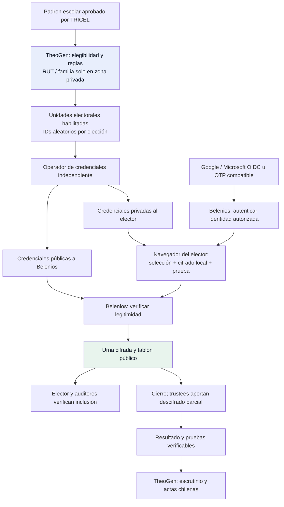
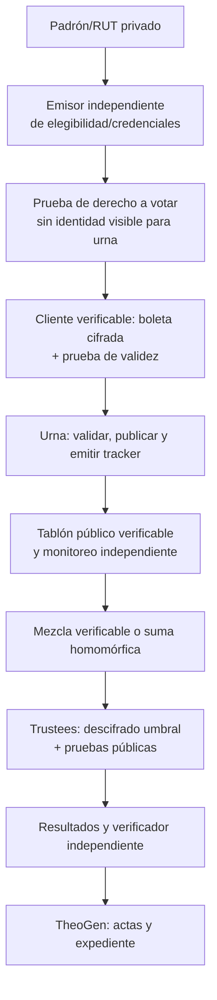
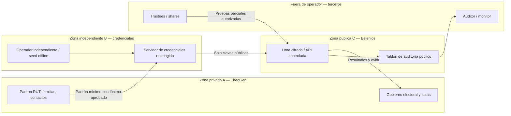

# ADR-001 — Selección del motor de votación para TheoGen Electoral

- **Estado:** ACEPTADO PARA IMPLEMENTACIÓN CONTROLADA de alternativa A; activación institucional/productiva pendiente.
- **Fecha:** 2026-10-27.
- **Ámbito:** TheoGen Electoral, centros de padres y apoderados y otras organizaciones.
- **Repositorio:** https://github.com/OsvaldoVegaOses/_Electoral
- **Base del diagnóstico:** rama `main`, commit `0b654e5883145d629f331807693a1db7c9b67134`.
- **Decisores:** titular del proyecto, asesoría jurídica electoral y revisión externa de seguridad (por designar).
- **Autorización de implementación:** el titular indicó «Implementa el ADR» el 2026-10-28, después de aprobar G1 y revisar H0–H4. Se implementa la gestión con Belenios 3.3.0 en una rama aislada, modo de laboratorio deshabilitado por defecto. No se autoriza despliegue productivo, datos reales, migración de votos históricos ni elección vinculante.
- **ADR relacionado:** pendiente de crear ADR de reglas electorales y política de revoto.

## 1. Contexto y problema

TheoGen Electoral ya gestiona instituciones, elecciones, padrones con RUT, opciones/candidaturas, credenciales UUID, voto público, escrutinio, actas y bitácora mediante React/Vite, FastAPI/SQLAlchemy y PostgreSQL. El MVP **no es apto todavía para elecciones vinculantes**: el modelo `Vote` almacena simultáneamente `voter_id` y `candidate_id`; existen riesgos de correlación por tiempos, registros y credenciales; la verificabilidad criptográfica no está demostrada y la exclusión por familia no es atómica bajo concurrencia. Véanse `backend/app/models.py`, `backend/app/routers/voting.py`, `backend/app/routers/reports.py` y `backend/app/routers/voters.py` [R1].

El objetivo no es añadir un simple cifrado a los registros actuales, sino demostrar que una persona habilitada puede votar conforme a reglas publicadas, sin que el operador reconstruya su selección y con escrutinio verificable por terceros independientes.

**Opciones:** (A) integrar una instancia autohospedada y versionada de Belenios; (B) desarrollar un motor propio sujeto a diseño formal y auditoría externa. La continuidad del motor actual como urna para elecciones reales **no es una opción aceptable**.

### 1.1 Requisitos no negociables

1. Elegibilidad y **una unidad electoral válida** (persona o familia, según estatutos); prevención de votos fraudulentos.
2. Secreto de elección frente al administrador de TheoGen, operador de infraestructura, comisión y observadores, bajo hipótesis de confianza explicitadas.
3. Separación entre identidad/RUT y contenido de boleta, incluyendo metadatos, registros y respaldos; transparencia sobre límites de anonimato en grupos pequeños.
4. Verificabilidad individual de inclusión y verificabilidad universal de validez/escrutinio, por un tercero sin privilegios de administrador; documentación de qué no se verifica.
5. Congelamiento de padrón, listas, reglas, fechas y preguntas antes de apertura, con huella verificable y procedimiento excepcional documentado.
6. Gobierno independiente de credenciales, llaves y escrutinio; acceso mínimo y trazabilidad sin revelar selección.
7. Recuperación de credenciales, operación degradada, respaldo, continuidad y respuesta a incidentes **sin reintroducir la posibilidad de descubrir el voto**.
8. Actas adaptables a normativa, personalidad jurídica, estatutos y reglas de cada organización en Chile; no se presume que el voto remoto sea jurídicamente permitido.
9. Autohospedaje, exportación de evidencia, minimización de datos, derecho de acceso/corrección y retención definida; sin uso comercial de padrones.
10. Pruebas repetibles de autenticación, concurrencia, revoto, recuperación, fraude, fallas y escrutinio, más validación externa.

## 2. Decisión técnica autorizada

**Implementar A: Belenios 3.3.0 autohospedado**, manteniendo TheoGen Electoral para gestión institucional, convocatoria, padrón, gobierno electoral y expediente. El commit fijado es `337887bd1862c7cd057080b530fd80941bfc3c69`. La implementación controlada y sus pruebas se describen en [implementación ADR-001](../motor/implementacion_adr001.md). Segregación administrativa real, entrega de credenciales, reglas institucionales, AGPL, auditoría y activación productiva conservan gates independientes. Si falla un requisito bloqueante, no se habilita el uso real ni se construye B como atajo.

**No implementar B como atajo.** Un motor propio solo pasa a una fase de diseño si un equipo especializado entrega especificación formal, pruebas de seguridad, auditoría independiente, plan económico y autorización expresa. No inventar criptografía ni diseñar protocolos por intuición.

### 2.1 Versión y evidencia de Belenios

- **Versión candidata reproducible: etiqueta `3.3.0`** del repositorio upstream, con archivo `VERSION=3.3.0`; fijar su commit exacto, hashes del artefacto, dependencias e imagen de construcción en la prueba de concepto. La rama `master` consultada ya declara `4.0.0~dev` y **no debe instalarse implícitamente** como versión estable [B1, B2].
- `RELEASE_NOTES.md` de 3.3.0 indica que dejó de admitir contraseñas estáticas generadas para votantes y eliminó el soporte AES-CCM en la PKI. La prueba debe usar la autenticación disponible en 3.3.0, no asumir que documentación histórica permanece vigente [B2].
- **API pública comprobada en el árbol de 3.3.0:** `doc/API.md` documenta `/api/`, `Authorization: Bearer`, `If-Match`, creación de borradores (`elections`), padrón (`elections/$UUID/draft/voters`), credenciales públicas, cambio de estado, recepción/listado de boletas y archivos de auditoría. La existencia documental **no prueba** estabilidad contractual ni integración con TheoGen: se debe probar cada operación y sus permisos en la etiqueta exacta [B3].
- **Licencia:** código interno bajo GNU AGPL-3.0-or-later con excepción OpenSSL indicada por upstream; dependencias `vendor/` con licencias propias. Autohospedar y modificar puede activar obligaciones de ofrecimiento del código fuente a usuarios de la instancia vía red. Antes de comercializar integración, exigir análisis jurídico del esquema de despliegue, modificaciones, avisos y distribución del código; no presumir que separar procesos elimina todas las obligaciones [B4].
- **Seguridad documentada, no garantía absoluta:** Belenios usa boletas cifradas, credenciales de firma, pruebas criptográficas, publicación de datos electorales y verificación mediante `belenios-tool`. Sus garantías dependen de su configuración, de las verificaciones y del comportamiento de actores confiables; no equivale a inmunidad frente a coacción, malware de dispositivo o colusión [B5, B6].
- **Antecedente de evaluación:** el propio proyecto menciona una campaña CSPN no exitosa en su anuncio de 3.1; no afirmar certificación aprobada ni invulnerabilidad [B7].

## 3. Alternativa A — Belenios autohospedado

### 3.1 Fronteras y responsabilidades

| Componente/actor | Información estrictamente necesaria | No debe recibir/controlar |
|---|---|---|
| TheoGen institucional | RUT normalizado, datos mínimos de contacto, reglas, titular de derechos, estado de elegibilidad | Credenciales privadas de voto, elección individual, claves de descifrado |
| Comisión electoral / TRICEL | Validación del padrón y reglas, actas, huellas de configuración, incidencias | Selección individual del votante o control unilateral de todas las claves |
| Operador de credenciales (externo) | Lista seudónima autorizada de unidades electorales y material de custodia requerido | Privilegios para manipular la urna o descifrar votos |
| Servidor de credenciales | Solo datos imprescindibles para emisión/reenvío de credenciales | Acceso permanente al secreto del operador y capacidad libre de suplantación |
| Belenios autohospedado | Configuración aprobada, credenciales públicas y/o asociación operacional requerida por protocolo, boletas cifradas, registros de participación | RUT original y base maestra de familias; claves completas de descifrado |
| Autoridades de descifrado (trustees) | Su propia parte de clave, huellas públicas, desafío de escrutinio | Padrón nominativo y control de las partes de otros trustees |
| Auditor independiente | Datos públicos, herramientas verificadoras, hashes y actas | Acceso a RUT, credenciales privadas o claves secretas |
| Elector | Información de su habilitación, credencial individual y comprobante de inclusión | Material de otro elector o resultado parcial de urnas abiertas |

Belenios 3.2 introdujo una **división del rol de autoridad de credenciales** en *credential operator* (custodia una semilla y aprueba recuperación) y *credential server* (almacena credenciales privadas cifradas y opera distribución). Esta división existe en `doc/cred.md` de la etiqueta 3.3.0; exige verificar los supuestos de no compromiso durante generación y reenvíos. Reusar un único administrador/servidor en ambos roles reduce las garantías [B8].

Para descifrado, preferir un esquema umbral multi-autoridad —como propuesta inicial a validar: **2 de 3** o **3 de 5**— con miembros independientes y ejercicio de recuperación. No seleccionar el umbral solo por conveniencia; documentar disponibilidad, colusión, pérdidas y revocaciones. Si se usa el modo de mayor restricción, verificar su configuración efectiva en la etiqueta elegida [B5, B9].

### 3.2 Flujo de identidad, emisión y escrutinio (objetivo lógico)

**El dibujo representa separación de funciones, no especificación de endpoints ni prueba de anonimato.** Debe contrastarse contra cómo Belenios 3.3.0 enlaza login, credencial pública, boleta y registros. Ninguna cuenta OIDC debe habilitarse fuera del padrón aprobado.

### 3.3 Contrato de integración: estudio antes de código productivo

PoC acotada: crear una elección ficticia por API documentada; preparar padrón seudónimo; asignar credenciales con operador independiente; configurar autenticación soportada; efectuar votos de prueba, revotar, cerrar, contar, exportar el archivo público y correr verificación con herramienta **en máquina separada**. Validar errores, idempotencia, reintentos, rate limits, CSRF/CORS, cobertura de callbacks, compatibilidad de versión, diferencias entre API y UI, autenticación de la administración y formatos de datos. **No asumir que Belenios ofrece una API genérica de emisión de credenciales, un SDK o OAuth pasante de TheoGen.**

Interoperabilidad mínima que demostrar:

| Caso | Evidencia de aprobación |
|---|---|
| Provisionar elección y preguntas | Borrador resultante, hash de configuración y sincronización sin valores divergentes |
| Congelar padrón | Lista aprobada, huella verificable y rechazo de altas/cambios posteriores |
| Vincular acceso sin RUT en urna | Ensayo de intercambio, mapeo mínimo y análisis de correlación |
| Generar/reemitir credencial | Trazas de operador independiente, revocación/recuperación sin duplicación de voto |
| Emitir/confirmar/revotar | Tracker público correcto, política seleccionada y eventos reproducibles |
| Abrir/cerrar/escrutar | Autorización de comisión, fechas, roles y ausencia de resultados prematuros |
| Verificar por tercero | `belenios-tool` ejecuta verificación en otra máquina, sin credenciales de administrador |
| Exportar acta chilena | Concordancia de totales, nulos/blancos y huellas con pruebas publicadas |
| Restaurar | Ensayo de base/archivo y custodia de claves, sin secretos expuestos |

### 3.4 Autenticación (Google / Microsoft) NO implica voto secreto

OAuth 2.0 delega autorización; **OpenID Connect (OIDC)** agrega autenticación e identidad. Google y Microsoft Entra ID pueden usarse como proveedores OIDC si la versión/flujo elegido de Belenios es compatible. `doc/auth.md` de Belenios 3.3.0 documenta autenticación OIDC y mecanismos específicos para administración/votantes [B10].

- Autenticarse prueba control de una identidad/cuenta según el proveedor, no derecho a votar: la pertenencia al padrón debe verificarse aparte.
- La cuenta autenticada **no rompe automáticamente** el vínculo identidad→boleta. El secreto depende de credenciales independientes, protocolo, configuración, metadatos y no colusión.
- No dar por válidos dominio de correo, RUT o cuenta institucional como equivalentes. Revisar identificador estable del proveedor, verificación de correo, duplicados y cambios de correo.
- Permitir alternativa accesible si una familia no posee Google/Microsoft o el colegio no gestiona cuentas: OTP u otro flujo **confirmado para la versión exacta**, con protección contra secuestro de correo.
- No entregar tokens de acceso/identidad de Google/Microsoft al motor de urna salvo que el protocolo lo exija y esté documentado; nunca conservarlos en actas o logs.
- Evitar que proveedor de identidad, servidor de credenciales y administrador de urna queden bajo una misma persona sin mitigaciones.

### 3.5 Revoto: política por definir y condición bloqueante

**Hecho confirmado:** la documentación pública de Belenios indica revoto permitido durante la elección y cómputo exclusivo del **último** sufragio válido; puede mitigar ciertas coacciones leves, pero no coerción fuerte. El *smart ballot tracker* anterior deja de representar el voto activo. [B5, B6].

**Verificado funcionalmente en laboratorio:** H2 comprobó revoto permitido y `<deny-revote/>` por UI/API; H4 añadió una unidad familiar y la integración ejecutó otra elección completa desde TheoGen hasta resultado verificado. La directiva sigue siendo global al proceso, no por elección. El [informe H0](../poc-belenios/01-factibilidad-y-contrato.md) fija el commit y el flujo; [H2](../poc-belenios/04-resultados-verificacion.md) y [H4](../poc-belenios/05-compatibilidad-theogen-chile.md) conservan pruebas y límites. La selección jurídica de R1/R2 por institución permanece pendiente.

| Política | Descripción | Consecuencias |
|---|---|---|
| R1 — último voto válido | Puede reemplazar boleta hasta cierre; solo la última se cuenta | Coincide con comportamiento Belenios documentado; observar auditoría de reemplazos y coerción |
| R2 — primer voto irrevocable | Segundo sufragio rechazado | `<deny-revote/>` global existe en 3.3.0; probar rechazo backend/UI/API y límites de recuperación antes de afirmar cumplimiento |
| R3 — revoto excepcional supervisado | Cambio solo con acta de incidencia y reglas estrictas | No asumir compatibilidad criptográfica; riesgo de control indebido de sufragio |

**Recomendación provisional:** R1 si normativa y estatutos lo permiten y hay protocolo claro de revoto; la comisión y responsable jurídico deben aprobar explícitamente R1/R2/R3. **Prohibido simular R2 bloqueando solo la interfaz TheoGen:** Belenios seguiría pudiendo aceptar boletas por su canal propio. Si R2 es indispensable y no es soportado, detener integración y reconsiderar producto/motor.

### 3.6 Voto familiar y votos ponderados

El MVP ofrece “un voto por familia”. Debe precisar la **unidad electoral jurídica** antes de elegir motor: una familia, un padre/apoderado, un tutor registrado o una delegación formal no son necesariamente equivalentes.

Diseño preferido: padrón escolar → agrupación justificada de electores → **exactamente una unidad electoral y una credencial votante por familia** (o representante acreditado antes del congelamiento), evitando asignar dos credenciales votantes independientes a miembros de la misma familia. Validar casos: hermanos en diferentes cursos; tutores separados; dos apoderados habilitados; familias reconstituidas; derecho de voto por alumno frente a por hogar; impugnaciones.

Belenios dispone de **voto ponderado** en su documentación, pero ese mecanismo no equivale a voto familiar compartido. Nunca usar ponderación para simular bloqueo familiar sin reglas y ensayos específicos [B11].

Para R1, la misma unidad familiar podría revotar por su único canal autorizado: **no equivale** a que distintos familiares puedan votar independientemente. Toda política de delegación/representante debe quedar en estatutos y acta, sin transferencias espontáneas de credencial.

### 3.7 Licencia, datos y exportabilidad

- Instancia propia sobre servidor y dominio bajo control del proyecto; verificar dónde residen base de datos, correos, DNS, logs y copias. Autohospedar elimina dependencia del **servidor público** de Belenios, pero no elimina dependencia tecnológica del software, mantenedores, compilador y bibliotecas.
- Cláusulas con colegios: responsable/encargado según análisis jurídico, propiedad/control del padrón, usos autorizados, no comercialización, subencargados, incidencias y destrucción.
- Publicar exclusivamente el conjunto criptográfico necesario para verificación: **nunca** RUT, correos, domicilios, IDs de familia o correspondencia identidad–credencial; inspeccionar formatos reales para prevenir divulgación indirecta.
- Retención y borrado definidos en sección 8; no aplicar sin análisis los plazos del **servidor público** de Belenios a la instancia autohospedada.
- Licencia y adaptaciones: inspección de AGPL, avisos de origen, ofertas de fuente, licencia de módulos modificados y condiciones de marcas por asesor jurídico.

## 4. Alternativa B — Motor propio

**Admisibilidad:** solo para proceso de I+D sometido a revisión criptográfica independiente. Prohibido implementar con “AES + HMAC”, UUID, enlaces mágicos o un ledger por intuición y denominarlos voto secreto verificable.

### 4.1 Especificación formal obligatoria

Antes del código, entregar documento de requisitos y modelo de amenazas con propiedades formalmente expresadas: elegibilidad, unicidad por unidad electoral, exactitud, privacidad de contenido, privacidad frente a coacción (si se reclama), verificabilidad individual/universal, integridad/consistencia del tablón, resistencia a reemplazo/supresión y disponibilidad. Indicar hipótesis de confianza, frontera de clientes comprometidos, anonimato bajo urnas pequeñas, y qué propiedades **no** se garantizan.

Requerir: revisión de protocolos publicados y evaluados; elección justificada de esquema de boleta cifrada, pruebas de conocimiento cero, firmas/credenciales, agregación homomórfica **o** mezcla verificable según papeleta, descifrado umbral y publicación auditada. Formular y evaluar invariantes/protocolos con especialistas; no inventar primitivas criptográficas.

### 4.2 Flujo conceptual

Este diagrama no constituye un protocolo implementable; cada transición necesita definición matemática, ataques conocidos, seguridad composicional y pruebas.

### 4.3 Requisitos de equipo/evidencia

1. Ingeniero/a criptógrafo/a con experiencia publicable o auditada en e-voting.
2. Especialista de seguridad de aplicaciones e infraestructura; responsable de privacidad y protección de datos.
3. Revisión externa **independiente de autores** antes de elecciones reales; informe público con límites y vulnerabilidades.
4. Código reproducible, especificación exacta de formatos, pruebas adversariales, de concurrencia y por propiedades; implementación del verificador independiente.
5. Custodia de claves multi-autoridad con ceremonias, rotación, pérdida, reconstrucción limitada y destrucción.
6. Pruebas de recuperación y validación por comisión no técnica; accesibilidad y seguridad del cliente.
7. Presupuesto aprobado para auditorías, mantenimiento criptográfico y respuesta a vulnerabilidades.

**Riesgo económico:** desarrollo inicial, auditorías y mantenimiento mayores que integración de software existente. El control de propiedad intelectual no justifica debilitar privacidad ni verificabilidad.

## 5. Matriz de amenazas y supuestos de confianza

Escala: **P** probabilidad estimada (B/M/A), **I** impacto (B/M/A/C). Las clasificaciones son cualitativas y requieren revisión del equipo de seguridad.

| Amenaza / actor | P | I | Confianza exigida / control propuesto | Riesgo residual |
|---|---|---|---|---|
| Administrador vincula RUT con elección mediante base actual | A | C | Sustituir modelo directo; separar roles y datos; verificar metadatos | Correlación por tiempo y volúmenes bajos |
| Operador altera padrón después de apertura | M | A | Congelamiento, acta y huellas independientes; no edición sin reinicio formal | Error de padrón previo al cierre |
| Operador/servidor fabrica votos si conoce credenciales privadas | M | C | Autoridad de credenciales realmente independiente, material privado fuera del operador de urna | Compromiso en momento de emisión |
| Dos miembros de familia votan simultáneamente | A | A | Una sola unidad/credencial habilitada, transacciones y pruebas concurrencia | Suplantación del representante |
| Servidor sustituye, elimina o censura boletas | M | C | Tablón público, trackers, monitor independiente y alerta antes de cierre | Auditor inactivo / bloqueo de acceso |
| Trustees se coluden y abren votos | B/M | C | Umbral y separación de organizaciones/personas | Colusión umbral o filtración de shares |
| Se pierde cantidad suficiente de claves | M | A | Ensayo de custodia, verificación previa, umbral y contingencia | Escrutinio imposible; elección anulable |
| IdP de Google/Microsoft indisponible o cuenta ajena | M | A | Validación con padrón + segundo factor/alternativa registrada | Exclusión o suplantación |
| Se roba correo o credencial de voto | M | A | Canales separados, autenticación adicional, recuperación supervisada y revoto autorizado | Coacción dirigida / secuestro de canal |
| Malware/XSS en navegador modifica selección | M | C | Cliente auditado, CSP, publicación de código/fingerprint, comprobación independiente | Cliente o dispositivo hostil |
| Coacción / compra de voto en entorno remoto | M | C | Revoto cuando se autorice, información al elector, límites honestos | Coerción fuerte no resuelta |
| Ataque DDoS durante horario electoral | M | A | Limitar tráfico, capacidad, monitoreo, procedimiento de suspensión | Cierre irregular, desigualdad de acceso |
| Backup o logs revelan identidad–credencial | M | C | Seudonimización, minimización, cifrado, rotación, acceso segregado y destrucción | Compromiso del conjunto de capas |
| Pequeña urna revela selección por inferencia | M | A | Umbral mínimo de publicación y evitar reportes desagregados por curso | Inferencia por contexto externo |
| Integración altera escrutinio/acta | M | A | Acta derivada solo de resultados verificados, hashes, doble firma | Error humano de transcripción |
| AGPL y dependencias incumplidas | M | A | Revisión jurídica, SBOM y publicación exigida de código | Cambios de licencia/dependencias |

**Modelo de confianza Belenios:** no se debe confiar en el mismo actor como administrador de padrón, emisor de credenciales privadas, operador de urna, conjunto suficiente de trustees y auditor. Belenios permite configuraciones debilitadas que concentran roles; **no serán aceptables** para el objetivo del proyecto [B5, B6, B8]. Para motor propio deberá formalizarse y auditarse el mismo supuesto, sin extrapolar garantías.

## 6. Separación lógica/física y controles de infraestructura

**Lógica:** bases y servicios separados; secretos con cuentas dedicadas; cuentas de servicio mínimas, rotación y segmentación por institución; sin llaves privadas en frontend ni logs; telemetría con datos minimizados y sin tracking de voto.

**Física recomendada para elección vinculante:** al menos tres dominios administrativos distintos: operador TheoGen/urna; autoridad de credenciales; trustees independientes. Contenedores separados **en una misma VM y bajo la misma cuenta root** no constituyen separación de confianza suficiente contra operador privilegiado. Evaluar hosting separado para credenciales, hardware y custodia offline de trustees, cuentas y respaldos fuera del alcance unilateral del operador.

Acceso de administración con MFA y justificación; doble control para apertura/cierre; TLS y CSP; reproducción de compilación y verificación de binarios; tablero firmado o supervisado externamente. Sin trazas que unan sesión, IP, hora y selección del voto.

## 7. Gestión de llaves, recuperación y continuidad

| Material | Custodio | Respaldo/uso | Retiro |
|---|---|---|---|
| RUT/identidad/contacto | Institución / TheoGen según contrato | Cifrado, acceso limitado, copia privada separada | Borrado seguro según calendario y obligaciones |
| Tabla identidad→unidad electoral | Responsable del padrón | Solo hasta validación y reclamaciones autorizadas | Destruir correspondencia innecesaria |
| Semilla/credenciales privadas | Operador independiente de credenciales | Custodia sellada y cifrada; recuperación verificada, con doble control | Destruir tras cierre/validación y plazos pertinentes |
| Credenciales públicas | Belenios / auditores | Publicables según protocolo, con huella y consistencia | Conservar solo según expediente aprobado |
| Claves privadas de trustees | Cada trustee por separado | Custodia offline cifrada, test previo y controles de pérdida | Destruir tras escrutinio validado según protocolo |
| Configuración y evidencia de urna | Belenios + monitor independiente | Archivos íntegros y backups versionados fuera del operador | Conservación probatoria definida |
| Claves TLS/API/servicio | Administradores de cada dominio | Gestor de secretos, rotación y revocación | Revocar ante incidente |

**Recuperación:** diferenciar pérdida de cuenta OIDC, pérdida de credencial de voto, pérdida de llave trustee, caída de servidor y pérdida de boletas. Reemitir credencial no debe agregar una unidad electoral ni permitir conocer una selección. Perder suficientes claves trustee puede volver **imposible** el escrutinio: no prometer recuperación inexistente [B9].

**Plan de continuidad:** RPO/RTO objetivos por definir con la organización; snapshots cifrados de configuración y urna, copia de evidencia del monitor, ensayo previo de restauración y congelamiento de emergencia, bitácora de incidentes, mecanismo estatutario de suspensión/repetición. No restaurar un estado que silenciosamente descarte votos previamente confirmados: contrastar trackers/evidencia independiente antes de reanudar.

## 8. Padrón, RUT, retención de datos y actas chilenas

### 8.1 Padrón y RUT

- El RUT es identificador personal y debe permanecer en la **zona privada del padrón**. Validar módulo 11 y normalización, pero la validación matemática **no acredita identidad ni derecho a sufragio**.
- Congelar padrón con número de personas y **número de unidades electorales habilitadas** por regla; registrar correcciones justificadas antes de apertura. Evitar que deduplicación de RUT se use como sustituto de deduplicación familiar.
- Usar IDs aleatorios únicos por elección hacia credenciales; no enviar a Belenios ni a su tablón público RUT, `familia_id`, nombre de niño/curso o hash simple del RUT (susceptible a enumeración).
- Si se requiere huella de cotejo privado, usar construcción con clave secreta por elección y custodiar el secreto fuera del motor, sin atribuirle anonimato absoluto. Mantener tabla de correspondencias separada y restringida solo mientras sea indispensable.
- **Incidencias:** apoderados separados, reclamación de habilitación, fallecimiento/retiro, cambios de correo, conflictos de custodias, duplicación de familias y sustitución del representante. Enviar a resolución del TRICEL; no resolver automáticamente a partir de apellido o dirección.
- Padrón y modelos de actas no incluirán opciones votadas por persona; los informes de participación evitarán segmentos que permitan inferencia por grupos pequeños.

### 8.2 Retención y normativa de datos

Al 27/10/2026 rige la Ley 19.628 en su texto vigente. La Ley 21.719 tiene vigencia diferida desde **01/12/2026**; diseñar desde ahora para su entrada en vigor. Clasificación responsable/encargado, base jurídica, información al titular, minimización, subencargados, incidentes, retención y ejercicio de derechos requieren asesoría jurídica actualizada [CL1, CL2].

**Política propuesta, pendiente de aprobación legal:** separar (a) padrón nominativo; (b) credenciales/semillas y sus correspondencias; (c) logs operacionales; (d) boletas cifradas y pruebas públicas; (e) actas firmadas y expediente. Cada categoría tendrá finalidad, plazo, fundamento, custodio, respaldos afectados y prueba de destrucción. Evitar prometer una cantidad fija de días sin conocer plazos estatutarios, impugnaciones y obligaciones legales. La publicación criptográfica pública puede requerir tratamiento especial por riesgo de correlación.

La política de conservación de la plataforma pública de Belenios **no se hereda automáticamente** en servidores propios: configurarla y probarla expresamente, incluso en copias y spool.

### 8.3 Actas, resultados y normativa chilena

Antes de habilitar una elección se debe clasificar jurídicamente al Centro de Padres: sin personalidad jurídica, con personalidad bajo Ley 19.418 u otra forma asociativa, y examinar **estatutos, reglamento interno, convocatoria y reglas aplicables**. El Decreto 565/1990 es referencia general, pero no certifica por sí solo que toda elección remota sea admisible [CL3].

**Especificación mínima de expediente/actas parametrizable, sujeta a validación jurídica:**

- Organización, identificación del proceso, estatutos/reglas, convocatoria, fechas/horas, integrantes de comisión y firma.
- Cierre del padrón, total de personas versus unidades habilitadas, reglas de representación familiar, exclusiones e impugnaciones.
- Constancia de apertura, configuración y huellas, custodia de credenciales y trustees, incidencias/suspensiones.
- Resultados verificables por opción/lista, blancos/nulos **según cómo se modelan en el motor**, participación calculada sobre unidades habilitadas, escrutinio y reglas de empate.
- Referencia reproducible a archivo público Belenios, versión, digest, comando/verificador, informe del auditor y firmas o validaciones de miembros de comisión.
- No afirmar automáticamente que el nulo consiste en un botón “Voto Nulo”: modelación de papeleta y validez debe acordarse conforme a estatutos y semántica del motor.

No asumir que Belenios entrega por defecto actas con formato chileno; TheoGen generará el documento desde resultados **ya verificados**, sin modificar cifras ni ocultar diferencias.

## 9. Costo total, beneficios y riesgos de ejecución

No hay cotizaciones comerciales disponibles: las comparaciones son **cualitativas**, no valores CLP inventados.

| Rubro | Belenios autohospedado | Motor propio |
|---|---|---|
| Licencia del motor | Sin tarifa de licencia AGPL; obligaciones de cumplimiento | Titularidad del código propio; licencias de dependencias |
| Adaptador e integración | Media/alta; versión y flujos reales pueden exigir trabajo | Muy alta; construir también API y operación |
| Revisión criptográfica | Necesaria para integración y parámetros; reutiliza diseño investigado | Crítica e intensiva desde especificación hasta implementación |
| Infraestructura | Servidor Belenios, monitor, credenciales, backups, correo y trustees | Lo mismo, más componentes propios de verificación |
| Operación de elecciones | Formación comisión/operador/trustees, soporte y ensayos | Igual, más custodia y mantenimiento de protocolo |
| Actualizaciones | Seguimiento de upstream, API/formatos, seguridad y AGPL | Responsabilidad íntegra de vulnerabilidades y evolución criptográfica |
| Diferenciación comercial | En gestión, operación, experiencia, documentos, soporte y confianza | Control del motor, sujeto a costo/tiempo/validación |
| Riesgo principal | Incompatibilidad revoto/familia/API/licencia y configuración débil | Errores criptográficos difíciles de detectar y auditar |

**TCO a presupuestar por escenario**: inicio = integración + evaluación legal + diseño de segregación + auditoría + pilotos; anual = hosting + mensajería + monitoreo + soporte + parches + reposición de llaves + reauditorías. Cotizar por volumen de electores, número de elecciones/año, número de trustees, nivel de disponibilidad y proveedor de infraestructura. Evitar comparaciones porcentuales sin base de costos.

## 10. Matriz de decisión y gates

Criterios ponderados propuestos (no puntuación definitiva): secreto y verificabilidad 30%; ajuste jurídico/familiar/revoto 20%; confianza y custodia independientes 15%; interoperabilidad 15%; costos y mantenimiento 10%; experiencia, accesibilidad y actas 10%.

| Criterio | Belenios 3.3.0 | Motor propio |
|---|---|---|
| Protocolo y verificabilidad conocidos | Documentado y probado en proyecto externo; configurar y verificar | Por especificar, demostrar y auditar |
| Interfaz de integración | API documentada; contrato y comportamiento deben ensayarse | Control completo de interfaz, pero desarrollo mayor |
| Voto familiar | Requiere modelado de unidad/representante | Puede diseñarse; no implica seguridad automática |
| Política de revoto R2 | Rechazo backend/UI/API probado en instancia 3.3.0; no supone protección contra root o rollback, y falta aprobación institucional | Posible solo con protocolo formal y revisión |
| Independencia de credenciales/trustees | Soportada, necesita operadores independientes | Debe diseñarse y auditarse |
| Licenciamiento | AGPL y dependencias, revisión necesaria | Control IP propio; dependencias y auditoría necesarias |
| Plazo/costo relativo | Opción preferida para exploración | Alto y de riesgo elevado |
| Decisión | **Implementación controlada autorizada; producción bloqueada** | **No iniciar construcción** |

### Gate G0 — Revisión documental (aprobable sin tocar el motor)
Confirmar tag/commit de 3.3.0, semántica de API, OpenID Connect/OTP soportado, retención, AGPL, controles familiares, revoto, formato de pruebas y requerimientos chilenos. Entrega: informe de factibilidad y matriz “demostrado/no demostrado/bloqueante”.

### Gate G1 — Prueba de concepto aislada (requiere autorización explícita)
Aprobar alcance, responsables, entorno sin datos reales, configuración de autoridades, casos de prueba y presupuesto. Medir integración real, firma/inclusión de boletas, verificabilidad externa, revoto familiar, recuperación y actas. Entrega: evidencias reproducibles y reporte de riesgos.

### Gate G2 — Decisión de motor y política de revoto (requiere aprobación explícita)
Elegir A, otra plataforma auditada o iniciativa de diseño B; aprobar R1/R2/R3, unidad electoral y responsabilidades. Si no hay soporte fiable de requisitos bloqueantes, **NO-GO**.

Registro 2026-10-28: el titular autorizó implementar A mediante «Implementa el ADR». Se exige R1/R2 explícito por elección de laboratorio, sin default. Esto no acredita aprobación jurídica, representantes reales ni custodios independientes: G2 institucional sigue parcial; G3/G4 no se activan.

### Gate G3 — Piloto no vinculante
Solo después de correcciones del backend TheoGen (RBAC/multiinstitución, credenciales, auditoría, congelamiento, concurrencia, CORS/logs, migraciones), revisión externa, control de privacidad y operación de comisión. No declarar aptitud para elecciones oficiales.

### Gate G4 — Elección vinculante
Dictamen jurídico por institución/tipo de elección, reglas y actas aprobadas, auditores externos, simulacro, plan de incidentes, garantía operacional, informe de seguridad y aceptación formal del responsable.

## 11. Consecuencias, límites y cuestiones abiertas

**Consecuencias favorables de A:** aprovechamiento de mecanismos criptográficos investigados, herramientas de verificación, separación de roles y foco de TheoGen en su diferenciación real (gestión electoral y soporte).

**Consecuencias desfavorables de A:** dependencia de upstream, tecnologías OCaml/compilación, integración entre dos aplicaciones, complejidad de autoridades, AGPL, necesidad de profesionalizar operación, posibles incompatibilidades con “primer voto irreversible” y algunas prácticas familiares.

**Consecuencias de B:** posible adaptación fina a requerimientos, pero riesgo y costo de demostrar garantías sustancialmente mayores. No debe confundirse flexibilidad de código con seguridad demostrable.

**Cuestiones abiertas bloqueantes:**
1. ¿Revoto R1 o voto único irreversible R2 es jurídicamente/estatutariamente exigido para cada cliente?
2. ¿Quién representa legalmente a la familia cuando el padrón contempla varios apoderados?
3. ¿Cómo documentar errores de padrón una vez validada la elección?
4. ¿Qué modalidad de Belenios 3.3.0 ofrece autenticación practicable para padres con y sin cuentas externas?
5. ¿Quién operará las credenciales independientes y quiénes serán trustees (y en qué jurisdicción)?
6. ¿Cuáles son los límites concretos de interoperabilidad de `doc/API.md`, las variantes de revoto y los requerimientos de soporte/actualización?
7. ¿Qué contenido de la evidencia debe publicarse y cuál debe archivarse privadamente para evitar reidentificación?
8. ¿Qué normas y estatutos permiten voto remoto, revoto, blanco/nulo y firma de actas para cada clase de organización?

## 12. Criterio de aprobación formal

La decisión técnica A está autorizada para implementación controlada por el titular de esta sesión, el 2026-10-28. Para activar una institución se deben registrar además política R1/R2, unidad electoral jurídica, responsables y custodios, evaluaciones jurídica/criptográfica, alcance del piloto y aceptación de riesgos. La autorización de implementación no sustituye esas evidencias ni declara aprobado G3/G4.

**Instrucción para agentes IA y desarrolladores:** G1 y la implementación controlada de A están autorizados por el titular. Conservar las fronteras de identidad/boleta, el bloqueo productivo y los gates restantes. No construir criptografía propia, desplegar, usar cuentas/padrones reales ni migrar votos históricos sin autorización del gate correspondiente. La publicación o fusión del ADR no activa elecciones.

## 13. Fuentes y evidencias (consultadas 2026-10-27)

**Repositorio TheoGen**
- [R1] Código actual: https://github.com/OsvaldoVegaOses/_Electoral/tree/0b654e5883145d629f331807693a1db7c9b67134/backend/app

**Belenios upstream — referencia exacta 3.3.0**
- [B1] Versión fijada: https://github.com/glondu/belenios/blob/3.3.0/VERSION
- [B2] Notas de actualización: https://github.com/glondu/belenios/blob/3.3.0/RELEASE_NOTES.md
- [B3] API documentada para 3.3.0: https://github.com/glondu/belenios/blob/3.3.0/doc/API.md
- [B4] Licencia y presentación: https://github.com/glondu/belenios/blob/3.3.0/README.md ; https://www.belenios.org/software.html
- [B5] Principios criptográficos: https://www.belenios.org/howitworks.html
- [B6] Roles/verificación/revoto: https://www.belenios.org/instructions.html
- [B7] Comunicados de releases: https://www.belenios.org/
- [B8] Nuevo protocolo de credenciales: https://github.com/glondu/belenios/blob/3.3.0/doc/cred.md
- [B9] Configuración y operación: https://github.com/glondu/belenios/blob/3.3.0/doc/web.md ; https://www.belenios.org/setup.html
- [B10] Autenticación OIDC y CAS: https://github.com/glondu/belenios/blob/3.3.0/doc/auth.md
- [B11] FAQ, revoto y votos ponderados: https://www.belenios.org/faq.html
- Verificador: https://github.com/glondu/belenios/blob/3.3.0/doc/tool.md

**Chile**
- [CL1] Ley 19.628 (vigencia a octubre 2026): https://www.bcn.cl/leychile/Navegar?idNorma=141599
- [CL2] Ley 21.719 (vigencia desde 2026-12-01): https://www.bcn.cl/leychile/Navegar?idNorma=1209272
- [CL3] Decreto 565/1990 Centros de Padres: https://www.bcn.cl/leychile/Navegar?idNorma=14275

---
**Estado:** implementación controlada de A autorizada. **Producción, piloto institucional y elección vinculante siguen bloqueados por sus gates.**
